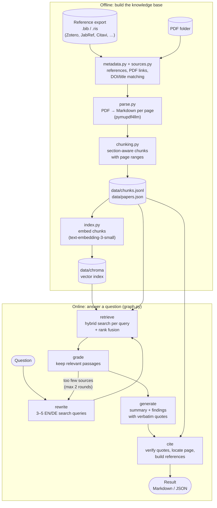
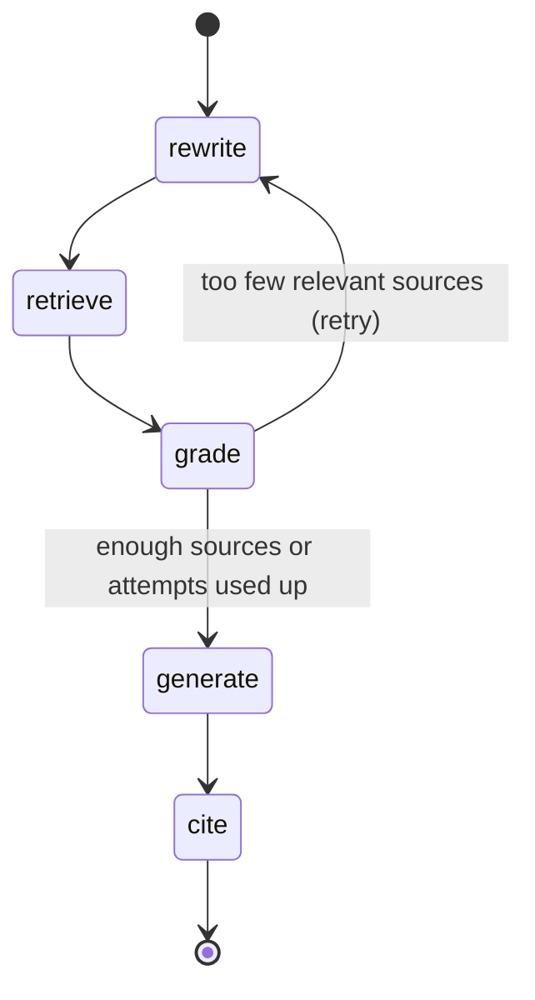
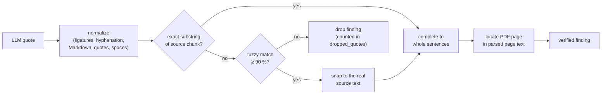

# ArticlesAgent

A retrieval-augmented generation (RAG) system for your own library of scientific papers, managed in
**Zotero, JabRef, Citavi, Mendeley, EndNote** or any tool that exports BibTeX or RIS.
Ask a research question in English or German and get back:

- a short **summary** with inline author–year–page citations,
- a list of **findings**, each backed by a **verbatim quote** from a paper (checked against the PDF text),
- the exact **PDF page** and **section** of every quote,
- an APA-style **reference list** generated from your reference manager's export.

Built with LangChain, LangGraph, Chroma and Azure OpenAI.

---

## Contents

1. [Pipeline overview](#1-pipeline-overview)
2. [Setup](#2-setup)
3. [Stage 1 – Ingestion](#3-stage-1--ingestion)
4. [Stage 2 – Indexing](#4-stage-2--indexing)
5. [Stage 3 – Retrieval](#5-stage-3--retrieval)
6. [Stage 4 – Answer graph (LangGraph)](#6-stage-4--answer-graph-langgraph)
7. [Quote verification and citations](#7-quote-verification-and-citations)
8. [Usage](#8-usage)
9. [Evaluation and tests](#9-evaluation-and-tests)
10. [Configuration reference](#10-configuration-reference)
11. [Project layout and data files](#11-project-layout-and-data-files)
12. [Limitations and roadmap](#12-limitations-and-roadmap)

---

## 1. Pipeline overview

The system has an **offline part** (run once, then again whenever the library changes) and an
**online part** (run for every question).



| Stage | Module | Input | Output | Uses LLM? |
|---|---|---|---|---|
| Ingestion | `ingest.py` | library sources (export + PDFs) | `chunks.jsonl`, `papers.json` | no |
| Indexing | `index.py` | chunks | Chroma vector index | embeddings only |
| Retrieval | `retriever.py` | query | ranked chunks | embeddings only |
| Answering | `graph.py` | question | `Result` with cited findings | yes |

---

## 2. Setup

### Requirements

- Python 3.11–3.13 (the project venv uses 3.12) and [uv](https://docs.astral.sh/uv/)
- A reference library with PDFs, exported as **BibTeX/BibLaTeX** or **RIS** (see
  [Supported reference managers](#supported-reference-managers))
- An Azure OpenAI resource with three deployments (a single chat deployment can serve both roles):

| Role | Env variable | Current deployment |
|---|---|---|
| Embeddings | `AZURE_OPENAI_EMBEDDING_DEPLOYMENT` | `text-embedding-3-small` |
| Answer generation | `AZURE_OPENAI_CHAT_DEPLOYMENT` | `gpt-4.1-mini` |
| Query rewriting, relevance grading | `AZURE_OPENAI_FAST_DEPLOYMENT` (optional, falls back to chat) | `gpt-4.1-mini` |

### Installation

```bash
cd ~/Documents/AgenticAI/ArticlesAgent
uv venv --python 3.12 .venv
uv pip install --python .venv/bin/python -e .
.venv/bin/streamlit run app.py --server.address localhost   # → http://localhost:8501
```

On first start, the app opens a **setup page** with three steps:

1. **Azure OpenAI connection:** endpoint, key and deployment names, saved to `.env` and tested with
   one small call per deployment.
2. **Reference library:** choose the reference manager, give the export file (path, or upload) and
   the PDF folder. **Check** previews how many references and PDFs were found. You can add
   several libraries; papers that appear in more than one are kept only once.
3. **Build database:** parsing and embedding run in the background with a progress bar (roughly
   1–2 minutes per 10 PDFs, depending on the embedding rate limit). When it is done, the app switches
   to the chat.

Instead of the form, `.env` can also be written by hand (`cp .env.example .env`):

```ini
AZURE_OPENAI_ENDPOINT=https://<resource>.cognitiveservices.azure.com/
AZURE_OPENAI_API_KEY=...
AZURE_OPENAI_EMBEDDING_DEPLOYMENT=text-embedding-3-small
AZURE_OPENAI_CHAT_DEPLOYMENT=gpt-4.1-mini
AZURE_OPENAI_FAST_DEPLOYMENT=gpt-4.1-mini
```

The code talks to Azure through the **v1 API** (`<endpoint>/openai/v1/`), so no `api-version` is
needed. `.env` is git-ignored; never commit it.

### Supported reference managers

| Manager | What to export | PDF folder | How PDFs are found |
|---|---|---|---|
| **Zotero** | *File → Export Library…* → **BibLaTeX** (or Better BibLaTeX), *Export Files* off | `~/Zotero/storage` | `file` field (absolute paths) |
| **JabRef** | the library `.bib` itself | optional | `file` field, relative to the library's *General file directory* |
| **Citavi** | *File → Export → Export references…* → **BibTeX** or RIS | project's **Citavi Attachments** | no links exported → matched by DOI / title |
| **Mendeley** | Desktop: *File → Export…* → BibTeX; Reference Manager: *Export* → BibTeX | folder with your PDFs | `file` field if present, else DOI / title |
| **EndNote** | *File → Export…*, style **RefMan (RIS) Export** | `<Library>.Data/PDF` | `L1` / `internal-pdf://` links, else DOI / title |
| **Other** | any `.bib` or `.ris` | folder with the PDFs | links, else DOI / title |

PDF links are resolved in this order: as written (absolute), relative to the JabRef file directory, the
PDF folder or the export's folder, and finally **by file name** inside the PDF folder. The last step
covers Windows paths in an export used on Linux, libraries that were moved, and EndNote's
`internal-pdf://`.

PDFs in the PDF folder that no reference links to are **matched** to references without a PDF:
first by a DOI printed on the first two pages, then by title (in the file name, then in the
first-page text, ≥ 92 % similarity). PDFs that match no reference become **papers of their own**,
cited from Crossref (DOI lookup) or the PDF's own metadata. Copies of a paper that already has a PDF
are skipped. All this PDF probing is cached in `library/cache/`.

### Command line instead of the app

```bash
.venv/bin/python -m articles_agent.libraries check citavi ~/export.bib --pdfs "~/Citavi/Projekt/Citavi Attachments"
.venv/bin/python -m articles_agent.libraries add   zotero ~/Zotero/export.bib --pdfs ~/Zotero/storage   # adds + builds
.venv/bin/python -m articles_agent.libraries list | sync | remove <id>
```

---

## 3. Stage 1 – Ingestion

`python -m articles_agent.ingest` turns the library into citable text chunks.

### 3.1 Metadata (`metadata.py`, `sources.py`)

The library consists of **sources** (stored in `library/sources.json`): each is one export file plus an
optional PDF folder, as configured in the app. The export is the source of truth for citations.

- **BibTeX/BibLaTeX** (`read_bibtex`): citation key (used as `paper_id` everywhere), title, authors, year
  (`date` or `year`), venue (`journaltitle` / `journal` / `booktitle` / …), volume, number, pages,
  publisher, DOI, URL, and the `file` field in Zotero, JabRef or Mendeley syntax:

  ```
  file = {Full Text PDF:/home/u/Zotero/storage/AG6BZMSZ/Kallioras et al. - 2020 - ….pdf:application/pdf}
  file = {:papers/Kallioras2020.pdf:PDF}                      (JabRef, relative)
  file = {:C$\backslash$:/Users/u/Mendeley/Kallioras2020.pdf:pdf}   (Mendeley, Windows)
  ```
- **RIS** (`read_ris`): `TY`, `TI`/`T1`, `AU`/`A1`, `PY`/`Y1`/`DA`, `T2`/`JF`/`JO`, `VL`, `IS`, `SP`/`EP`, `DO`,
  `UR`, `PB`, and PDF links from `L1`/`L4` (`file://` or EndNote `internal-pdf://`). RIS has no
  citation keys, so keys are generated (`lastname_firstword_year`).

How the PDFs are resolved and matched is described in [Supported reference managers](#supported-reference-managers).
The papers of all sources are merged, and duplicates across sources (same DOI or title) are kept once.

### 3.2 Parsing (`parse.py`)

Each PDF is converted with **pymupdf4llm** into one Markdown string **per physical page**:

- headings become `#` lines, which enables section detection;
- running headers and footers are removed;
- OCR is disabled (Tesseract language data is not installed), so scanned pages come back empty and
  are listed in `data/ingest_report.json`.

Parsing runs in parallel (`ingest.workers` processes) and is **cached** in `data/parsed/<storage-key>.json`.
A PDF is parsed again only if it is newer than its cache file, or with `--reparse`.

### 3.3 Chunking (`chunking.py`)

Pages are split into paragraphs, and every paragraph gets the page number and the section heading
it belongs to (Markdown headings or bold numbered headings such as `**2. Methods**`). Paragraphs are
then packed into chunks:

- a chunk never crosses a **section boundary**;
- target size `chunk_size` = 2,500 characters (≈ 600 tokens); longer paragraphs are split at sentence
  boundaries;
- consecutive chunks of the same section overlap by up to `chunk_overlap` = 300 characters;
- each chunk stores `page_start` / `page_end`, so a chunk can span a page break.

Text cleanup: LaTeX-style umlauts (`L¨osung`) are repaired to `Lösung`, and image placeholders are removed.
Sections named *References / Bibliography / Literaturverzeichnis …* are flagged `is_references`.

A chunk record in `data/chunks.jsonl`:

```json
{
  "chunk_id": "kallioras_accelerated_2020:0014",
  "paper_id": "kallioras_accelerated_2020",
  "pdf_path": "/home/diego/Zotero/storage/AG6BZMSZ/….pdf",
  "section": "4.1 The outline of the DLTOP methodology",
  "page_start": 6, "page_end": 6,
  "is_references": false,
  "text": "Assuming, without loss of generality, that a structured finite element mesh …"
}
```

**Current library:** 273 PDFs → 23,828 chunks, of which 2,059 are reference lists.

Check the result:

```bash
.venv/bin/python -m articles_agent.inspect_chunks                             # library statistics
.venv/bin/python -m articles_agent.inspect_chunks kallioras_accelerated_2020  # all chunks of one paper
```

---

## 4. Stage 2 – Indexing

`python -m articles_agent.index` embeds the **searchable** chunks into a persistent Chroma
collection (`data/chroma`, cosine distance).

Which chunks are searchable (`store.load_chunks`):

- not a reference list (`chunking.exclude_references`);
- section heading doesn't match `index.exclude_sections` (contents, index, …);
- at least `index.min_chars` (80) characters.

→ **21,289 searchable chunks** in the current library.

What gets embedded is the chunk **plus its context**, which helps short chunks be found:

```
<paper title>
<section heading>

<chunk text>
```

Chroma metadata per chunk: `paper_id`, `section`, `page_start`, `page_end`, `year`, `short_cite`
(these allow filtering by paper or year).

Indexing is **incremental**: only chunks not yet in the collection are embedded, and chunks that
disappeared after a re-ingestion are deleted. The collection remembers which embedding model built
it, and refuses to run with a different one. After changing `AZURE_OPENAI_EMBEDDING_DEPLOYMENT`, run
`python -m articles_agent.index --rebuild`.

Rate limits (HTTP 429) are handled by automatic retries with back-off. Indexing speed is limited by
the deployment's tokens-per-minute (TPM) setting: about 9 M tokens took about 80 minutes at roughly 115 k TPM.

---

## 5. Stage 3 – Retrieval

`retriever.HybridRetriever.search(query, k, paper_ids, year_from, year_to)` combines two searches:

| Search | How | Good at |
|---|---|---|
| **Dense** | Chroma nearest neighbours of the query embedding | meaning, paraphrases, cross-language matches |
| **BM25** | keyword ranking (`rank-bm25`) over title + section + text, built in memory at start-up | exact terms, acronyms, symbols (SIMP, IPMSM, NSGA-II) |

Each search returns its top `retrieval.candidates` (50). The two lists are merged with
**reciprocal rank fusion (RRF)**:

```
score(chunk) = Σ  1 / (60 + rank_in_list)
```

RRF needs no score calibration between the two searches, and it rewards chunks that rank well in both.
Filters (`paper_ids`, `year_from`, `year_to`) are applied in both searches.

Try retrieval without an LLM:

```bash
.venv/bin/python -m articles_agent.search "surrogate models for electric motor design" -k 8
.venv/bin/python -m articles_agent.search "SIMP acceleration" --from 2019 --paper kallioras_accelerated_2020
```

---

## 6. Stage 4 – Answer graph (LangGraph)

`graph.py` defines a LangGraph `StateGraph` with five nodes. The state carries the question,
filters, queries, candidates, selected sources, the raw LLM answer and the final `Result`.



| Node | Model | What it does |
|---|---|---|
| **rewrite** | fast | Generates 3–5 search queries: at least one English and one German formulation, key terms, synonyms, acronyms. The original question is always kept as a query. On a retry it is told which queries failed and asked to broaden them. |
| **retrieve** | – | Runs the hybrid search for every query (`per_query_k` = 12 hits each) and fuses the lists with RRF again. Keeps the top `grade_candidates` (20). |
| **grade** | fast | Shows the 20 candidates (numbered `S1…S20`) and asks which ones *directly* help answer the question. Keeps at most `max_sources` (10), most useful first. |
| **generate** | chat | Writes the answer as **structured output** (JSON schema, strict): a `summary` citing sources inline as `[S1]`, and a list of `findings` `{claim, quote, source_id}`. Rules: use only the given sources, copy quotes verbatim (≤ 3 sentences, no ellipses, no merging), one point per finding, answer in the question's language with quotes in the source language, return no findings if the sources don't answer the question. |
| **cite** | – | Verifies the quotes and builds the citations; see next section. |

All LLM calls use structured output (`with_structured_output(..., method="json_schema", strict=True)`),
so the graph never parses free text.

Cost per question: 3 LLM calls (4–5 with a retry), about 15–25 k tokens in total, and about 12–20 s.

---

## 7. Quote verification and citations

Language models sometimes paraphrase or invent quotes. The `cite` node therefore treats every quote
as unverified until it has been found in the source chunk (`citations.match_quote`).



1. **Normalize** both texts the same way: Unicode NFKC (fi → fi), soft hyphens removed, words
   hyphenated at line ends re-joined, Markdown/HTML stripped, typographic quotes and dashes unified,
   whitespace collapsed.
2. **Exact match** (case-insensitive) → accepted (`exact: true`).
3. Otherwise a **fuzzy match** (RapidFuzz `partial_ratio_alignment`, threshold `fuzzy_threshold` = 90)
   finds the closest passage. The quote is **replaced by the actual source text** (`exact: false`),
   so the quote you get is always the paper's own wording.
4. Partial sentences are **completed to whole sentences**, by searching up to 200 characters in either direction.
5. No match → the finding is **dropped**, and the output says how many were dropped.
6. **Page location:** a chunk may span pages, so the start of the quote is searched in the cached
   per-page text of the PDF to find the exact page.

**Citations:**

- In-text labels are author–year (`Doi et al., 2019`), with `a/b` suffixes when two cited papers share
  a label.
- Summary markers such as `[S1, S4][S2]` become `(Doi et al., 2019, pp. 1, 4; Sasaki et al., 2021, p. 2)`.
- The reference list is formatted in APA 7 style from the bib metadata (authors with initials, year,
  title, *venue*, volume(number), pages, DOI link), and contains only papers that are actually cited.

> **Only the quotes are verified, not the summary.** The summary is the model's synthesis of the
> retrieved passages and can occasionally contain a statement or number that is not in any quoted
> passage. Use the findings as the citable evidence.

---

## 8. Usage

### Chat UI (Streamlit)

```bash
.venv/bin/streamlit run app.py --server.address localhost   # → http://localhost:8501
```

- **Chat:** questions in English or German; while the pipeline runs, a status box shows the
  generated queries and how many passages were found and selected.
- **Findings** appear as cards with the verbatim quote, the citation and the section, plus:
  - **Open in Zotero**: opens the PDF in Zotero at the quoted page
    (`zotero://open-pdf/library/items/<attachment-key>?page=N`; Zotero must be installed and running);
  - **Show surrounding passage**: the full chunk the quote comes from.
- **Sidebar filters:** publication-year range (papers without a year are excluded while it is set)
  and a restriction to selected papers.
- **Export:** each answer, or the whole session, as Markdown.
- **📚 Libraries:** list, add, remove and re-sync reference-manager libraries.
- **➕ Add single papers:** upload PDFs or import a folder (see §11).
- **⚙️ Azure connection:** change endpoint, key or deployments, and test them.
- Database updates run in a **separate background process**: you can keep chatting, and a progress
  bar in the sidebar shows the stage. The index reloads automatically when the update is done.
- Each question is answered independently; follow-up questions don't see earlier answers.

`--server.address localhost` keeps the app private to this machine. Without it, Streamlit listens
on all network interfaces, and anyone on the same network could use the app and therefore your
Azure quota.

### Command line

```bash
# ask a question (Markdown on stdout)
.venv/bin/python -m articles_agent.ask "How is deep learning used to accelerate topology optimization of electric motors?"

# German question, restricted to papers from 2020 on, saved to a file
.venv/bin/python -m articles_agent.ask "Welche Surrogatmodelle werden für die Motoroptimierung eingesetzt?" --from 2020 -o answer.md

# restrict to specific papers (citation keys from the .bib); raw JSON output
.venv/bin/python -m articles_agent.ask "What dataset was used?" --paper sasaki_explainable_2021 --json
```

### Python

```python
from articles_agent.graph import ask

result = ask("How can the Pareto front be computed faster?", year_from=2019)
print(result.to_markdown())
for f in result.findings:
    print(f.citation, f.section, f.quote)
```

### Output format

```markdown
## <question>

<summary with inline citations (Author et al., Year, p. N)>

### Findings

**1. <claim in the question's language>**

> “<verbatim quote from the paper>”
>
> — (Doi et al., 2019, p. 5), section *IV. CONCLUSION*

### References

- Doi, S., Sasaki, H., & Igarashi, H. (2019). Multi-Objective Topology Optimization of Rotating
  Machines Using Deep Learning. *IEEE Transactions on Magnetics*, 55(6), 1–5. https://doi.org/10.1109/TMAG.2019.2899934
```

`Result.to_dict()` / `--json` additionally gives `paper_id`, `chunk_id`, `page`, `exact`, the generated
search `queries` and `dropped_quotes`.

---

## 9. Evaluation and tests

Retrieval quality is measured against questions whose answers you already know, in `eval/questions.yaml`:

```yaml
- question: How can deep belief networks reduce the number of SIMP iterations in topology optimization?
  papers: [kallioras_accelerated_2020]   # one or more correct citation keys
  pages: [6, 7]                           # optional
```

```bash
.venv/bin/python -m articles_agent.eval_retrieval
```

It reports hit@1 / hit@5 / hit@10 (was a correct paper among the top k chunks), the MRR (mean reciprocal
rank), and how often the correct page was in the top 10. The file currently holds 4 starter examples
and should be extended to 10–20 questions from your own research. Run it after every change to
chunking, embeddings or retrieval settings, to see whether the change actually helps.

Note: `eval_retrieval` tests the **plain hybrid search** (stage 3) with the question as the only query.
The full graph adds query rewriting, which, for example, makes German questions find English papers.

### Automated tests

```bash
uv pip install --python .venv/bin/python -e ".[test]"
.venv/bin/python -m pytest                       # ~25 s, offline, no Azure costs
.venv/bin/python -m pytest -m "not integration"  # without subprocess / server tests
ARTICLES_AGENT_LIVE_TESTS=1 .venv/bin/python -m pytest -m live   # real Azure deployments (a few cents)
```

Every test runs in a **temporary installation**: its own `library/`, `data/` and `.env`, three generated
sample papers (English, German, and one without a reference entry), **fake models** in place of Azure
(`tests/fakes.py`: hashing embeddings, a scripted chat model that also returns one invented quote), and
the network blocked. Your real library, index and `.env` are never touched.

| File | What it checks |
|---|---|
| `test_metadata.py` | BibTeX/BibLaTeX and RIS readers, `file` fields of Zotero/JabRef/Mendeley (Linux and Windows), encodings, citation keys, DOIs |
| `test_chunking.py` | sections, page ranges across page breaks, reference lists, chunk size/overlap, umlaut repair |
| `test_citations.py` | quote verification (exact, near-verbatim snapping, rejection), page location, APA references, labels, Markdown output |
| `test_pdfmeta.py` | DOI/title/text probing and its cache, Crossref and arXiv lookups (mocked), rejection of a cited paper's DOI, fallbacks |
| `test_sources.py` | every reference manager's PDF linking/matching, preview, adding/removing libraries, de-duplication across libraries |
| `test_library.py` | single-PDF import with duplicate detection, upload path safety, the database update in a separate process |
| `test_pipeline.py` | ingestion → index → hybrid search with filters → LangGraph answer: invented quote dropped, pages and references correct, retry loop, incremental re-runs |
| `test_settings_jobs.py` | saving `.env` (file mode 600), connection check, background job runner |
| `test_app.py` | the Streamlit UI headless (AppTest): setup page for a new user → build → chat, answers, filters, errors, adding/removing papers and libraries |
| `test_deployment.py` | **web hosting**: server health endpoint, data home separate from code (`ARTICLES_AGENT_HOME`), configuration via environment variables only, API key never sent to the browser, dependencies declared, no personal paths, `.gitignore` |
| `test_live_azure.py` | opt-in: every deployment responds, and the real model follows the citation contract |

**Public hosting checklist.** `test_deployment.py` also contains tests marked
`xfail(strict=True)` for what is still missing before the app can face anonymous visitors on a website:

1. visitors can enter server file/folder paths (library export, PDF folder);
2. visitors can change the Azure settings and manage libraries (needs an admin-only area);
3. there is no login (anyone with the URL spends your Azure quota);
4. *Open PDF* runs `xdg-open` on the server instead of sending the PDF to the browser;
5. the upload size isn't limited (`.streamlit/config.toml`).

They show up as `xfailed`. Once one of them is fixed, pytest reports `XPASS(strict)` as a failure:
remove that test's marker, and from then on the check is enforced.

### Deployment notes

- `ARTICLES_AGENT_HOME=/srv/articles-agent` keeps `.env`, `library/` and `data/` outside the code
  folder (e.g. on a persistent volume). Without its own `config.yaml`, the shipped one is used.
- Azure settings can come from environment variables alone; a `.env` file is optional.
- Health check for a proxy or orchestrator: `GET /_stcore/health` → `ok`.

---

## 10. Configuration reference

All settings live in `config.yaml`; secrets and deployment names live in `.env` (editable in the app
under *⚙️ Azure connection*). The libraries are configured in the app and stored in `library/sources.json`.

| Key | Default | Meaning |
|---|---|---|
| `data_dir` | `data` | generated files |
| `ingest.workers` | 4 | parallel PDF parser processes |
| `chunking.chunk_size` | 2500 | target chunk size (characters) |
| `chunking.chunk_overlap` | 300 | overlap within a section (characters) |
| `chunking.exclude_references` | true | keep reference lists out of the index |
| `index.batch_size` | 128 | chunks per embedding request |
| `index.min_chars` | 80 | drop smaller fragments |
| `index.exclude_sections` | contents, index, … | regexes on section headings |
| `retrieval.k` | 8 | default hits for `search` |
| `retrieval.candidates` | 50 | hits per search method before fusion |
| `answer.per_query_k` | 12 | hits kept per rewritten query |
| `answer.grade_candidates` | 20 | passages shown to the grader |
| `answer.max_sources` | 10 | passages given to the answer model |
| `answer.min_sources` | 2 | below this, rewrite and search again |
| `answer.max_attempts` | 2 | maximum search rounds |
| `answer.fuzzy_threshold` | 90 | similarity (%) for snapping a near-verbatim quote |

After changing `chunking.*`, run `ingest` and then `index`; parsing is not repeated. After changing
`index.*`, run only `index`. `retrieval.*` and `answer.*` take effect immediately.

---

## 11. Project layout and data files

```
ArticlesAgent/
├── README.md
├── pyproject.toml          dependencies
├── config.yaml             settings (see §10)
├── .env / .env.example     Azure endpoint, key, deployment names
├── eval/
│   └── questions.yaml      retrieval benchmark
├── tests/                  pytest suite (see §9), fixtures in conftest.py, fake models in fakes.py
├── src/articles_agent/
│   ├── config.py           loads config.yaml, resolves paths
│   ├── metadata.py         BibTeX / RIS readers → Paper records
│   ├── sources.py          library sources: PDF link resolution, DOI/title matching, merging
│   ├── pdfmeta.py          DOIs / title / text from PDFs, Crossref lookup (cached)
│   ├── jobs.py             background job runner for the app
│   ├── ui_library.py       app widgets: setup, libraries, Azure settings, progress
│   ├── libraries.py        CLI: list / check / add / remove / sync library sources
│   ├── parse.py            PDF → per-page Markdown
│   ├── chunking.py         section-aware chunking, text cleanup
│   ├── ingest.py           CLI: parse + chunk the whole library
│   ├── inspect_chunks.py   CLI: inspect ingestion results
│   ├── store.py            shared access to chunks, papers, page cache, Chroma
│   ├── llm.py              Azure OpenAI chat + embedding clients (v1 API)
│   ├── index.py            CLI: embed chunks into Chroma
│   ├── retriever.py        hybrid dense + BM25 search with RRF
│   ├── search.py           CLI: retrieval only
│   ├── eval_retrieval.py   CLI: retrieval benchmark
│   ├── graph.py            LangGraph answer pipeline
│   ├── citations.py        quote verification, page location, APA references
│   ├── results.py          Result / CitedFinding + Markdown rendering
│   ├── ask.py              CLI: ask a question
│   ├── library.py          import non-Zotero PDFs: metadata, duplicates, registry
│   └── add.py              CLI: add PDF files / folders
├── app.py                  Streamlit chat UI
├── library/                per-installation library data, git-ignored
│   ├── sources.json        configured libraries (manager, export file, PDF folder)
│   ├── extra_papers.json   individually added PDFs
│   ├── uploads/            PDFs / exports uploaded through the UI
│   └── cache/              PDF probes and Crossref answers
└── data/                   generated, git-ignored
    ├── parsed/             per-PDF page cache (<storage-key>.json)
    ├── chunks.jsonl        all chunks
    ├── papers.json         bibliographic metadata per paper_id
    ├── ingest_report.json  parse errors, PDFs with blank pages
    └── chroma/             vector index
```

### Updating the library

**Papers added in the reference manager:** export the library again (to the same file), then click
**🔄 Re-sync all libraries** (sidebar → *📚 Libraries*), or run `python -m articles_agent.libraries sync`.
Only new or changed PDFs are parsed, and only new chunks are embedded. New PDFs in the PDF folder are
picked up even before the next export; they are matched or cited from Crossref until the export
contains them.

**Another library** (e.g. a Citavi project next to Zotero): sidebar → *📚 Libraries* → *Add a library*.
**Removing** a library there also removes its papers from the database.

**PDFs that belong to no library** (single files or whole folders):

- UI: sidebar → **➕ Add single papers** → upload PDF files and/or enter a folder path (searched
  recursively) → **Add to library**.
- CLI: `python -m articles_agent.add paper.pdf ~/Papers/new_batch [--no-crossref]`

What happens (`library.py`):

1. **Duplicates are skipped**: same file path, same file content (SHA-256), a DOI that is already in
   the library, or a title that is ≥ 95 % identical to an existing one.
2. **Citation metadata:** the DOI printed on the first two pages is looked up at **Crossref** (only the
   DOI is sent). The result is accepted only if Crossref's title also appears in the PDF text. Fallbacks,
   in order: the PDF's embedded title/author properties, the largest-font text on page 1, the file name.
   These fallbacks give no year or venue (cited as *n.d.*).
3. The paper is recorded in `library/extra_papers.json`, with a citation key such as
   `lastname_firstword_year`. Uploaded files are copied to `library/uploads/`, while folder PDFs are used
   in place (so don't move them afterwards).
4. Ingestion and indexing then run incrementally, and the UI reloads the index.

To correct the metadata of an imported paper, edit its entry in `library/extra_papers.json` and run
`python -m articles_agent.ingest && python -m articles_agent.index`. To remove an imported paper,
delete its entry and run the same commands; its chunks are then removed from the index.

In answers, imported papers get an **Open PDF** button, which opens the file in the default viewer
without jumping to the page, instead of *Open in Zotero*.

---

## 12. Limitations and roadmap

**Known limitations**

- No OCR: scanned PDFs or pages without a text layer can't be found (35 PDFs have some blank pages,
  mostly books with figure-only pages).
- Formulas and tables come out of the PDF as plain text and are hard to quote meaningfully. Figure
  captions are sometimes mixed into the body text.
- Section detection depends on the PDF layout. Some chunks have a generic section such as the paper title.
- Results vary slightly between runs (grading and generation are LLM-based).
- Only quotes are verified; the summary is LLM synthesis (see §7).
- With the free Azure tier, data is processed in *Global Standard* deployments, so it may be processed outside the EU.
- `gpt-4.1-mini` occasionally produces quotes longer than 3 sentences, or findings whose quotes can't be
  verified (these are dropped). A larger chat model follows the rules more reliably; switching only
  requires changing `AZURE_OPENAI_CHAT_DEPLOYMENT`.

**Roadmap**

- [x] Ingestion: parsing, metadata, chunking
- [x] Hybrid index and retrieval, retrieval benchmark
- [x] LangGraph answer pipeline with verified, page-accurate citations
- [x] Streamlit chat UI: chat history, expandable sources, year/paper filters, Markdown export
- [x] Setup page for new users; Zotero, JabRef, Citavi, Mendeley, EndNote and generic BibTeX/RIS libraries
- [ ] Batch topic reports: `topics.yaml` → one cited Markdown/DOCX report per topic
- [ ] Extend `eval/questions.yaml` to 10–20 questions; optionally add a cross-encoder reranker
