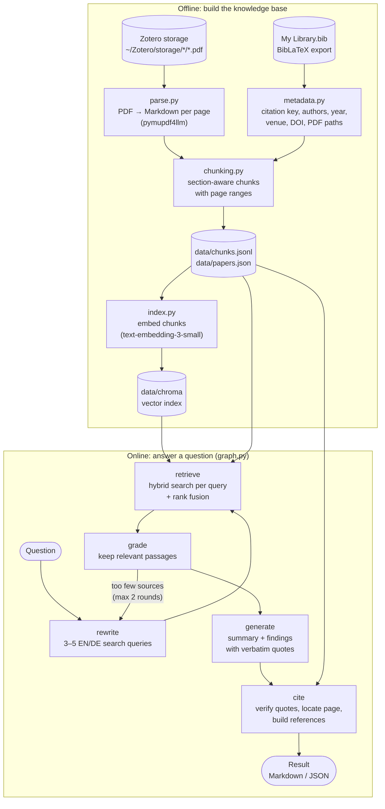
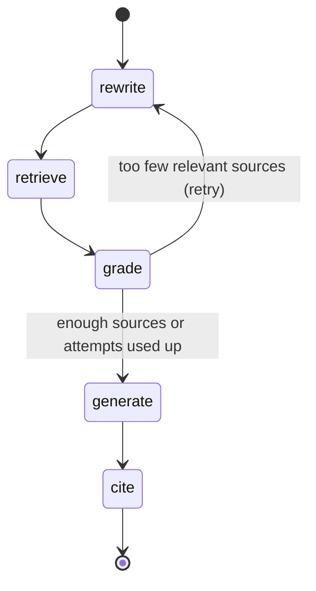
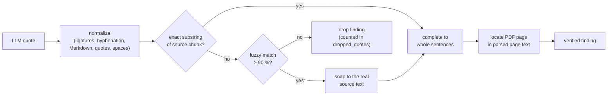

# ArticlesAgent

A retrieval-augmented generation (RAG) system for a personal **Zotero library** of scientific papers.
Ask a research question in English or German and get back:

- a short **summary** with inline author–year–page citations,
- a list of **findings**, each backed by a **verbatim quote** from a paper (checked against the PDF text),
- the exact **PDF page** and **section** of every quote,
- an APA-style **reference list** generated from the Zotero BibTeX export.

Built with LangChain, LangGraph, Chroma and Azure OpenAI.

---

## Contents

1. [Pipeline overview](#1-pipeline-overview)
2. [Setup](#2-setup)
3. [Stage 1 – Ingestion](#3-stage-1--ingestion)
4. [Stage 2 – Indexing](#4-stage-2--indexing)
5. [Stage 3 – Retrieval](#5-stage-3--retrieval)
6. [Stage 4 – Answer graph (LangGraph)](#6-stage-4--answer-graph-langgraph)
7. [Quote verification and citations](#7-quote-verification-and-citations)
8. [Usage](#8-usage)
9. [Evaluation](#9-evaluation)
10. [Configuration reference](#10-configuration-reference)
11. [Project layout and data files](#11-project-layout-and-data-files)
12. [Limitations and roadmap](#12-limitations-and-roadmap)

---

## 1. Pipeline overview

The system has an **offline part** (run once, then again whenever the library changes) and an
**online part** (run for every question).



| Stage | Module | Input | Output | Uses LLM? |
|---|---|---|---|---|
| Ingestion | `ingest.py` | PDFs + `.bib` | `chunks.jsonl`, `papers.json` | no |
| Indexing | `index.py` | chunks | Chroma vector index | embeddings only |
| Retrieval | `retriever.py` | query | ranked chunks | embeddings only |
| Answering | `graph.py` | question | `Result` with cited findings | yes |

---

## 2. Setup

### Requirements

- Python 3.11–3.13 (the project venv uses 3.12) and [uv](https://docs.astral.sh/uv/)
- A Zotero library with PDFs, plus a **BibLaTeX export** of it (`My Library.bib`, exported with the
  *Export Files* option off; the `file` field with the PDF paths must be present)
- An Azure OpenAI resource with three deployments (a single chat deployment can serve both roles):

| Role | Env variable | Current deployment |
|---|---|---|
| Embeddings | `AZURE_OPENAI_EMBEDDING_DEPLOYMENT` | `text-embedding-3-small` |
| Answer generation | `AZURE_OPENAI_CHAT_DEPLOYMENT` | `gpt-4.1-mini` |
| Query rewriting, relevance grading | `AZURE_OPENAI_FAST_DEPLOYMENT` (optional, falls back to chat) | `gpt-4.1-mini` |

### Installation

```bash
cd ~/Documents/AgenticAI/ArticlesAgent
uv venv --python 3.12 .venv
uv pip install --python .venv/bin/python -e .
cp .env.example .env      # then fill in endpoint, key and deployment names
```

`.env`:

```ini
AZURE_OPENAI_ENDPOINT=https://<resource>.cognitiveservices.azure.com/
AZURE_OPENAI_API_KEY=...
AZURE_OPENAI_EMBEDDING_DEPLOYMENT=text-embedding-3-small
AZURE_OPENAI_CHAT_DEPLOYMENT=gpt-4.1-mini
AZURE_OPENAI_FAST_DEPLOYMENT=gpt-4.1-mini
```

The code talks to Azure through the **v1 API** (`<endpoint>/openai/v1/`), so no `api-version` is
needed. `.env` is git-ignored; never commit it.

### Build the knowledge base

```bash
.venv/bin/python -m articles_agent.ingest   # ~15 min for 270 PDFs (parsing is cached)
.venv/bin/python -m articles_agent.index    # ~10–80 min, depends on the embedding TPM limit
```

---

## 3. Stage 1 – Ingestion

`python -m articles_agent.ingest` turns the library into citable text chunks.

### 3.1 Metadata (`metadata.py`)

The BibLaTeX export is the single source of truth for citations. For every entry it extracts the
citation key (used as `paper_id` everywhere), title, authors, year (from `date` or `year`), venue
(`journaltitle` / `booktitle` / …), volume, number, pages, publisher, DOI and URL.

The link between an entry and its PDF comes from Zotero's `file` field, which holds absolute paths:

```
file = {Full Text PDF:/home/diego/Zotero/storage/AG6BZMSZ/Kallioras et al. - 2020 - ….pdf:application/pdf}
```

PDFs in the storage folder that no bib entry links to are still included, with the file name as
title and `zotero_<storage-key>` as `paper_id` (they get no proper reference entry).

### 3.2 Parsing (`parse.py`)

Each PDF is converted with **pymupdf4llm** into one Markdown string **per physical page**:

- headings become `#` lines, which enables section detection;
- running headers and footers are removed;
- OCR is disabled (Tesseract language data is not installed), so scanned pages come back empty and
  are listed in `data/ingest_report.json`.

Parsing runs in parallel (`ingest.workers` processes) and is **cached** in `data/parsed/<storage-key>.json`.
A PDF is parsed again only if it is newer than its cache file, or with `--reparse`.

### 3.3 Chunking (`chunking.py`)

Pages are split into paragraphs, and every paragraph gets the page number and the section heading
it belongs to (Markdown headings or bold numbered headings such as `**2. Methods**`). Paragraphs are
then packed into chunks:

- a chunk never crosses a **section boundary**;
- target size `chunk_size` = 2,500 characters (≈ 600 tokens); longer paragraphs are split at sentence
  boundaries;
- consecutive chunks of the same section overlap by up to `chunk_overlap` = 300 characters;
- each chunk stores `page_start` / `page_end`, so a chunk can span a page break.

Text cleanup: LaTeX-style umlauts (`L¨osung`) are repaired to `Lösung`, and image placeholders are removed.
Sections named *References / Bibliography / Literaturverzeichnis …* are flagged `is_references`.

A chunk record in `data/chunks.jsonl`:

```json
{
  "chunk_id": "kallioras_accelerated_2020:0014",
  "paper_id": "kallioras_accelerated_2020",
  "pdf_path": "/home/diego/Zotero/storage/AG6BZMSZ/….pdf",
  "section": "4.1 The outline of the DLTOP methodology",
  "page_start": 6, "page_end": 6,
  "is_references": false,
  "text": "Assuming, without loss of generality, that a structured finite element mesh …"
}
```

**Current library:** 273 PDFs → 23,828 chunks, of which 2,059 are reference lists.

Check the result:

```bash
.venv/bin/python -m articles_agent.inspect_chunks                             # library statistics
.venv/bin/python -m articles_agent.inspect_chunks kallioras_accelerated_2020  # all chunks of one paper
```

---

## 4. Stage 2 – Indexing

`python -m articles_agent.index` embeds the **searchable** chunks into a persistent Chroma
collection (`data/chroma`, cosine distance).

Which chunks are searchable (`store.load_chunks`):

- not a reference list (`chunking.exclude_references`);
- section heading doesn't match `index.exclude_sections` (contents, index, …);
- at least `index.min_chars` (80) characters.

→ **21,289 searchable chunks** in the current library.

What gets embedded is the chunk **plus its context**, which helps short chunks be found:

```
<paper title>
<section heading>

<chunk text>
```

Chroma metadata per chunk: `paper_id`, `section`, `page_start`, `page_end`, `year`, `short_cite`
(these allow filtering by paper or year).

Indexing is **incremental**: only chunks not yet in the collection are embedded, and chunks that
disappeared after a re-ingestion are deleted. The collection remembers which embedding model built
it, and refuses to run with a different one. After changing `AZURE_OPENAI_EMBEDDING_DEPLOYMENT`, run
`python -m articles_agent.index --rebuild`.

Rate limits (HTTP 429) are handled by automatic retries with back-off. Indexing speed is limited by
the deployment's tokens-per-minute (TPM) setting: about 9 M tokens took about 80 minutes at roughly 115 k TPM.

---

## 5. Stage 3 – Retrieval

`retriever.HybridRetriever.search(query, k, paper_ids, year_from, year_to)` combines two searches:

| Search | How | Good at |
|---|---|---|
| **Dense** | Chroma nearest neighbours of the query embedding | meaning, paraphrases, cross-language matches |
| **BM25** | keyword ranking (`rank-bm25`) over title + section + text, built in memory at start-up | exact terms, acronyms, symbols (SIMP, IPMSM, NSGA-II) |

Each search returns its top `retrieval.candidates` (50). The two lists are merged with
**reciprocal rank fusion (RRF)**:

```
score(chunk) = Σ  1 / (60 + rank_in_list)
```

RRF needs no score calibration between the two searches, and it rewards chunks that rank well in both.
Filters (`paper_ids`, `year_from`, `year_to`) are applied in both searches.

Try retrieval without an LLM:

```bash
.venv/bin/python -m articles_agent.search "surrogate models for electric motor design" -k 8
.venv/bin/python -m articles_agent.search "SIMP acceleration" --from 2019 --paper kallioras_accelerated_2020
```

---

## 6. Stage 4 – Answer graph (LangGraph)

`graph.py` defines a LangGraph `StateGraph` with five nodes. The state carries the question,
filters, queries, candidates, selected sources, the raw LLM answer and the final `Result`.



| Node | Model | What it does |
|---|---|---|
| **rewrite** | fast | Generates 3–5 search queries: at least one English and one German formulation, key terms, synonyms, acronyms. The original question is always kept as a query. On a retry it is told which queries failed and asked to broaden them. |
| **retrieve** | – | Runs the hybrid search for every query (`per_query_k` = 12 hits each) and fuses the lists with RRF again. Keeps the top `grade_candidates` (20). |
| **grade** | fast | Shows the 20 candidates (numbered `S1…S20`) and asks which ones *directly* help answer the question. Keeps at most `max_sources` (10), most useful first. |
| **generate** | chat | Writes the answer as **structured output** (JSON schema, strict): a `summary` citing sources inline as `[S1]`, and a list of `findings` `{claim, quote, source_id}`. Rules: use only the given sources, copy quotes verbatim (≤ 3 sentences, no ellipses, no merging), one point per finding, answer in the question's language with quotes in the source language, return no findings if the sources don't answer the question. |
| **cite** | – | Verifies the quotes and builds the citations; see next section. |

All LLM calls use structured output (`with_structured_output(..., method="json_schema", strict=True)`),
so the graph never parses free text.

Cost per question: 3 LLM calls (4–5 with a retry), about 15–25 k tokens in total, and about 12–20 s.

---

## 7. Quote verification and citations

Language models sometimes paraphrase or invent quotes. The `cite` node therefore treats every quote
as unverified until it has been found in the source chunk (`citations.match_quote`).



1. **Normalize** both texts the same way: Unicode NFKC (fi → fi), soft hyphens removed, words
   hyphenated at line ends re-joined, Markdown/HTML stripped, typographic quotes and dashes unified,
   whitespace collapsed.
2. **Exact match** (case-insensitive) → accepted (`exact: true`).
3. Otherwise a **fuzzy match** (RapidFuzz `partial_ratio_alignment`, threshold `fuzzy_threshold` = 90)
   finds the closest passage. The quote is **replaced by the actual source text** (`exact: false`),
   so the quote you get is always the paper's own wording.
4. Partial sentences are **completed to whole sentences**, by searching up to 200 characters in either direction.
5. No match → the finding is **dropped**, and the output says how many were dropped.
6. **Page location:** a chunk may span pages, so the start of the quote is searched in the cached
   per-page text of the PDF to find the exact page.

**Citations:**

- In-text labels are author–year (`Doi et al., 2019`), with `a/b` suffixes when two cited papers share
  a label.
- Summary markers such as `[S1, S4][S2]` become `(Doi et al., 2019, pp. 1, 4; Sasaki et al., 2021, p. 2)`.
- The reference list is formatted in APA 7 style from the bib metadata (authors with initials, year,
  title, *venue*, volume(number), pages, DOI link), and contains only papers that are actually cited.

> **Only the quotes are verified, not the summary.** The summary is the model's synthesis of the
> retrieved passages and can occasionally contain a statement or number that is not in any quoted
> passage. Use the findings as the citable evidence.

---

## 8. Usage

### Command line

```bash
# ask a question (Markdown on stdout)
.venv/bin/python -m articles_agent.ask "How is deep learning used to accelerate topology optimization of electric motors?"

# German question, restricted to papers from 2020 on, saved to a file
.venv/bin/python -m articles_agent.ask "Welche Surrogatmodelle werden für die Motoroptimierung eingesetzt?" --from 2020 -o answer.md

# restrict to specific papers (citation keys from the .bib); raw JSON output
.venv/bin/python -m articles_agent.ask "What dataset was used?" --paper sasaki_explainable_2021 --json
```

### Python

```python
from articles_agent.graph import ask

result = ask("How can the Pareto front be computed faster?", year_from=2019)
print(result.to_markdown())
for f in result.findings:
    print(f.citation, f.section, f.quote)
```

### Output format

```markdown
## <question>

<summary with inline citations (Author et al., Year, p. N)>

### Findings

**1. <claim in the question's language>**

> “<verbatim quote from the paper>”
>
> — (Doi et al., 2019, p. 5), section *IV. CONCLUSION*

### References

- Doi, S., Sasaki, H., & Igarashi, H. (2019). Multi-Objective Topology Optimization of Rotating
  Machines Using Deep Learning. *IEEE Transactions on Magnetics*, 55(6), 1–5. https://doi.org/10.1109/TMAG.2019.2899934
```

`Result.to_dict()` / `--json` additionally gives `paper_id`, `chunk_id`, `page`, `exact`, the generated
search `queries` and `dropped_quotes`.

---

## 9. Evaluation

Retrieval quality is measured against questions whose answers you already know, in `eval/questions.yaml`:

```yaml
- question: How can deep belief networks reduce the number of SIMP iterations in topology optimization?
  papers: [kallioras_accelerated_2020]   # one or more correct citation keys
  pages: [6, 7]                           # optional
```

```bash
.venv/bin/python -m articles_agent.eval_retrieval
```

It reports hit@1 / hit@5 / hit@10 (was a correct paper among the top k chunks), the MRR (mean reciprocal
rank), and how often the correct page was in the top 10. The file currently holds 4 starter examples
and should be extended to 10–20 questions from your own research. Run it after every change to
chunking, embeddings or retrieval settings, to see whether the change actually helps.

Note: `eval_retrieval` tests the **plain hybrid search** (stage 3) with the question as the only query.
The full graph adds query rewriting, which, for example, makes German questions find English papers.

---

## 10. Configuration reference

All settings live in `config.yaml`; secrets and deployment names live in `.env`.

| Key | Default | Meaning |
|---|---|---|
| `library.bib_file` | `My Library.bib` | BibLaTeX export (relative to the project) |
| `library.storage_dir` | `/home/diego/Zotero/storage` | Zotero attachment folder |
| `data_dir` | `data` | generated files |
| `ingest.workers` | 4 | parallel PDF parser processes |
| `chunking.chunk_size` | 2500 | target chunk size (characters) |
| `chunking.chunk_overlap` | 300 | overlap within a section (characters) |
| `chunking.exclude_references` | true | keep reference lists out of the index |
| `index.batch_size` | 128 | chunks per embedding request |
| `index.min_chars` | 80 | drop smaller fragments |
| `index.exclude_sections` | contents, index, … | regexes on section headings |
| `retrieval.k` | 8 | default hits for `search` |
| `retrieval.candidates` | 50 | hits per search method before fusion |
| `answer.per_query_k` | 12 | hits kept per rewritten query |
| `answer.grade_candidates` | 20 | passages shown to the grader |
| `answer.max_sources` | 10 | passages given to the answer model |
| `answer.min_sources` | 2 | below this, rewrite and search again |
| `answer.max_attempts` | 2 | maximum search rounds |
| `answer.fuzzy_threshold` | 90 | similarity (%) for snapping a near-verbatim quote |

After changing `chunking.*`, run `ingest` and then `index`; parsing is not repeated. After changing
`index.*`, run only `index`. `retrieval.*` and `answer.*` take effect immediately.

---

## 11. Project layout and data files

```
ArticlesAgent/
├── README.md
├── pyproject.toml          dependencies
├── config.yaml             settings (see §10)
├── .env / .env.example     Azure endpoint, key, deployment names
├── My Library.bib          Zotero BibLaTeX export
├── eval/
│   └── questions.yaml      retrieval benchmark
├── src/articles_agent/
│   ├── config.py           loads config.yaml, resolves paths
│   ├── metadata.py         .bib → Paper records, PDF linking
│   ├── parse.py            PDF → per-page Markdown
│   ├── chunking.py         section-aware chunking, text cleanup
│   ├── ingest.py           CLI: parse + chunk the whole library
│   ├── inspect_chunks.py   CLI: inspect ingestion results
│   ├── store.py            shared access to chunks, papers, page cache, Chroma
│   ├── llm.py              Azure OpenAI chat + embedding clients (v1 API)
│   ├── index.py            CLI: embed chunks into Chroma
│   ├── retriever.py        hybrid dense + BM25 search with RRF
│   ├── search.py           CLI: retrieval only
│   ├── eval_retrieval.py   CLI: retrieval benchmark
│   ├── graph.py            LangGraph answer pipeline
│   ├── citations.py        quote verification, page location, APA references
│   ├── results.py          Result / CitedFinding + Markdown rendering
│   └── ask.py              CLI: ask a question
└── data/                   generated, git-ignored
    ├── parsed/             per-PDF page cache (<storage-key>.json)
    ├── chunks.jsonl        all chunks
    ├── papers.json         bibliographic metadata per paper_id
    ├── ingest_report.json  parse errors, PDFs with blank pages
    └── chroma/             vector index
```

### Updating the library

After adding papers to Zotero:

1. Export the library again as BibLaTeX to `My Library.bib`.
2. `python -m articles_agent.ingest`: parses only the new PDFs.
3. `python -m articles_agent.index`: embeds only the new chunks.

---

## 12. Limitations and roadmap

**Known limitations**

- No OCR: scanned PDFs or pages without a text layer can't be found (35 PDFs have some blank pages,
  mostly books with figure-only pages).
- Formulas and tables come out of the PDF as plain text and are hard to quote meaningfully. Figure
  captions are sometimes mixed into the body text.
- Section detection depends on the PDF layout. Some chunks have a generic section such as the paper title.
- Results vary slightly between runs (grading and generation are LLM-based).
- Only quotes are verified; the summary is LLM synthesis (see §7).
- With the free Azure tier, data is processed in *Global Standard* deployments, so it may be processed outside the EU.
- `gpt-4.1-mini` occasionally produces quotes longer than 3 sentences, or findings whose quotes can't be
  verified (these are dropped). A larger chat model follows the rules more reliably; switching only
  requires changing `AZURE_OPENAI_CHAT_DEPLOYMENT`.

**Roadmap**

- [x] Ingestion: parsing, metadata, chunking
- [x] Hybrid index and retrieval, retrieval benchmark
- [x] LangGraph answer pipeline with verified, page-accurate citations
- [ ] Streamlit chat UI: chat history, expandable sources, year/paper filters, Markdown export
- [ ] Batch topic reports: `topics.yaml` → one cited Markdown/DOCX report per topic
- [ ] Extend `eval/questions.yaml` to 10–20 questions; optionally add a cross-encoder reranker
